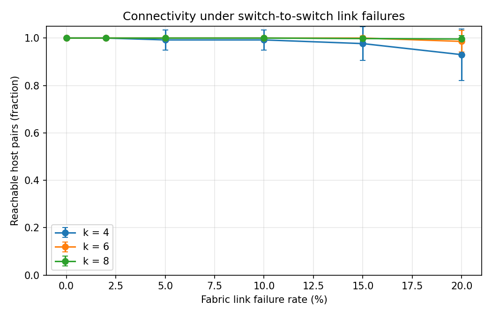
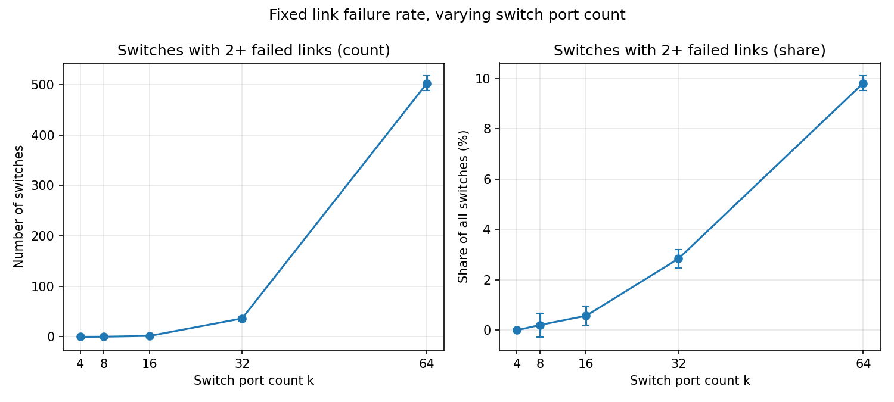

# Fat-Tree Topology: Generation and Link-Failure Analysis

Homework 1. Builds a k-ary fat-tree (Al-Fares, Loukissas, Vahdat, SIGCOMM 2008),
fails a random fraction of its switch-to-switch links, and measures how many host
pairs remain connected.

## Status

- [x] Topology generator for any even k ≥ 2 (`fattree.py`)
- [x] Link-failure model, switch-to-switch links only, seeded (`failures.py`)
- [x] Basic metric: fraction of reachable host pairs (`metrics.py`)
- [x] Command-line interface with JSON config support (`cli.py`)
- [x] Failure-rate sweep with CSV output and matplotlib plot (`experiment.py`)
- [x] Second analysis: switches with 2+ failed links at 1%, by k (`experiment_switches.py`)
- [x] Results and discussion (below)

## Setup

```powershell
python -m venv .venv
.venv\Scripts\activate
pip install -r requirements.txt
```

## Running a single scenario

```powershell
python cli.py --k 4 --failure-rate 0.05 --seed 1
```

Output:

```
k = 4
hosts: 16, switches: 20, links: 48 (fabric: 32)
failure rate: 0.05 (seed 1)
failed fabric links: 2 of 32
reachable host pairs: 120 of 120 (100.0%)
```

Or from a config file:

```powershell
python cli.py --config configs/example.json
python cli.py --config configs/example.json --seed 7
```

### Input parameters

| Parameter | CLI flag | Config key | Type | Default | Meaning |
|---|---|---|---|---|---|
| Switch port count | `--k` | `k` | int | required | Ports per switch. Must be even and ≥ 2. Gives k³/4 hosts. |
| Failure rate | `--failure-rate` | `failure_rate` | float | 0.0 | Fraction of **switch-to-switch** links that fail, in [0, 1]. |
| Random seed | `--seed` | `seed` | int | 42 | Seed for choosing failed links. Same seed, same failures. |
| Config file | `--config` | — | path | — | JSON file with the keys above. CLI flags override it. |

Precedence: built-in defaults < config file < command-line flags.
Unknown keys in a config file are rejected.

### Sweep experiment

```powershell
python experiment.py --config configs/sweep.json
```

`configs/sweep.json` keys:

| Key | Meaning |
|---|---|
| `k_values` | list of port counts to test |
| `failure_rates` | list of failure rates to test |
| `num_seeds` | number of random seeds per (k, rate) pair; runs use seeds 0 … num_seeds−1 |
| `out_dir` | output folder (created if missing) |

Outputs in `out_dir`:
- `reachability_raw.csv`: one row per (k, rate, seed)
- `reachability_summary.csv`: mean and standard deviation per (k, rate)
- `reachability_vs_failure.png`: plot of the mean with standard-deviation error bars

### Second experiment: switches with multiple failed links

```powershell
python experiment_switches.py --config configs/switches_1pct.json
```

The failure rate is fixed at 1%, k ∈ {4, 8, 16, 32, 64}, and each k runs 30 seeds. For each run, the experiment counts the switches that lose two or more of their fabric links, and also that count as a share of all switches. Outputs go to `results/switches_1pct/`: `switches_raw.csv`, `switches_summary.csv` and `switches_vs_k.png`.

## Failure model

- **Scope:** only switch-to-switch links (edge↔aggregation and aggregation↔core) can fail.
  Host↔edge links never fail, so a failure never disconnects a host from its own edge switch.
  Failing host links as well is left for future work.
- **Count:** the number of failed links is `round(rate × number_of_fabric_links)`.
  For k=4 there are 32 fabric links, so rate 0.05 fails round(1.6) = 2 links.
  Python's `round` sends exact halves (x.5) to the nearest even integer. Other values round normally.
- **Selection:** links are sorted into a fixed order, then a uniform random sample is drawn with `random.Random(seed)`.
  The result depends only on (k, rate, seed).
- **Sampling:** each fabric link is equally likely to fail. Links are drawn without replacement, so exactly `n_fail` links fail in every run. This makes the failures slightly negatively correlated, since one failure reduces the chance of another. There are no switch-level failures.

## Metric: reachable host pairs

For a damaged graph with H hosts:

```
reachable fraction = (Σ over components c of  h_c·(h_c − 1)/2) / (H·(H − 1)/2)
```

where h_c is the number of hosts in connected component c. This is the fraction of
unordered host pairs that still have at least one path between them.

Sanity values for k=4 (16 hosts, 120 pairs):
- no failures: 120 / 120 = 100%
- all fabric links failed: only the pairs under the same edge switch remain, 8 / 120 ≈ 6.7%

## Tests

```powershell
python -m pytest
```

Run with `python -m pytest`, not plain `pytest`, so the project folder is on the import path.

| File | What it checks |
|---|---|
| `tests/test_fattree.py` | Node and link counts match the formulas for k = 2, 4, 6, 8; switch degrees equal k; invalid k is rejected |
| `tests/test_failures.py` | Fabric-link count; rate 0 changes nothing; failed count = round(rate·E); rate 1 removes all fabric links; host links survive; same seed → same failures; original graph is not modified; invalid rate is rejected |
| `tests/test_metrics.py` | Healthy network gives 120/120; all fabric links failed gives 8/120; the fraction never rises as the failure rate rises |
| `tests/test_cli.py` | Output format; config file is read; CLI overrides config; missing k and unknown config keys are errors |
| `tests/test_switches.py` | The switch-counting metric on hand-made failure sets (none, disjoint, shared switch, path, star); sampling count and reproducibility; k=4 at 1% fails nothing |

## Topology reference

| Element | Count (k-ary fat-tree) |
|---|---|
| Pods | k |
| Edge switches | k²/2 |
| Aggregation switches | k²/2 |
| Core switches | (k/2)² |
| Hosts | k³/4 |
| Fabric links (switch-to-switch) | k³/2 |
| Total links | 3k³/4 |

Each pod has k/2 edge and k/2 aggregation switches. Every edge switch connects to every
aggregation switch in its pod. Aggregation switch `a` in each pod connects to core group `a`
(k/2 core switches). The topology has three tiers: edge, aggregation and core switches, as described in Section 2 of [1].

## Results

### Example 1: Reachable host pairs vs. failure rate, for k = 4, 6, 8



**Setup.** `configs/sweep.json`: k ∈ {4, 6, 8}, failure rates {0, 2, 5, 10, 15, 20}%,
30 seeds per point (seeds 0–29). Only switch-to-switch links fail. The metric is the
fraction of host pairs that remain connected. Each point is the mean over 30 runs, and the
error bars show one sample standard deviation. Raw values are in `results/reachability_raw.csv`.

**Results (mean ± std):**

| failure rate | k = 4 | k = 6 | k = 8 |
|---|---|---|---|
| 0% | 1.0000 ± 0.0000 | 1.0000 ± 0.0000 | 1.0000 ± 0.0000 |
| 2% | 1.0000 ± 0.0000 | 1.0000 ± 0.0000 | 1.0000 ± 0.0000 |
| 5% | 0.9922 ± 0.0426 | 1.0000 ± 0.0000 | 1.0000 ± 0.0000 |
| 10% | 0.9922 ± 0.0426 | 1.0000 ± 0.0000 | 1.0000 ± 0.0000 |
| 15% | 0.9767 ± 0.0712 | 1.0000 ± 0.0000 | 0.9980 ± 0.0111 |
| 20% | 0.9300 ± 0.1088 | 0.9860 ± 0.0455 | 0.9959 ± 0.0155 |

**Observations.**

1. **k = 4 is the most fragile.** It is the only setting where failures reduce connectivity
   at 5%, and at 20% the mean drops to 0.93. Its standard deviation is also the largest.
2. **Larger k is more robust.** At 20% the mean is 0.93 for k=4, 0.986 for k=6 and 0.996
   for k=8. The gap between k=4 and k=8 (0.93 vs 0.996) is much larger than the spread of k=8 (±0.016).
3. **The mean hides rare events.** For k=4 at 5%, a standard deviation of 0.0426 is what you
   get when one of 30 runs loses 28 of 120 pairs (value 0.7667) and the rest lose nothing.
   Seed 11 is one such run: in `reachability_raw.csv` it gives 0.76667. Two failed links on the
   same edge switch cut off both of its hosts, and 2 × 14 = 28 pairs are lost. Reporting the
   standard deviation, or the minimum, is needed to see this.
4. **Rates are rounded to whole links.** For k=4 there are 32 fabric links, so 5% and 10%
   fail 2 and 3 links (round(1.6) and round(3.2)). For k=4 the 2% point fails exactly one
   link, and a single failure never disconnects anything, because each edge switch has two
   uplinks. That is why the 0–2% part of the curve is flat at 1.0.

**Significance.** The curves show that the fat-tree's redundancy (two uplinks per edge
switch, and (k/2)² paths between pods) pays off. Small failure rates are absorbed without any
loss of connectivity, and the loss grows slowly with the rate. The main design lesson is that
port count matters: at the same failure rate, a larger k keeps more hosts connected.

**Limitations to discuss.**
- The metric measures *whether* hosts can reach each other, not performance. It does not
  measure path length, bandwidth or congestion, which would be the next step.
- Failures are uniform and drawn without replacement. Real failures often cluster on one switch or one
  rack, which would be worse than these results.
- The y-axis starts at 0, so the differences at small rates are hard to see. The plot is
  correct as is, but a zoomed view (y from 0.8 to 1.0) would show the k=4 curve better.

### Example 2: Switches with 2+ failed links at a 1% failure rate, as a function of k



**Setup.** `configs/switches_1pct.json`: k ∈ {4, 8, 16, 32, 64}, a fixed failure rate of 1% of switch-to-switch links, and 30 seeds per k. In each run, the experiment counts the switches that lose two or more of their fabric links. The left panel shows that count. The right panel shows it as a share of all switches (edge, aggregation and core).

**Results (mean ± std over 30 seeds):**

| k | failed links | switches | switches with 2+ failures | share of switches |
|---|---|---|---|---|
| 4 | 0 | 20 | 0.00 ± 0.00 | 0.00% |
| 8 | 3 | 80 | 0.17 ± 0.38 | 0.21% |
| 16 | 20 | 320 | 1.83 ± 1.21 | 0.57% |
| 32 | 164 | 1280 | 36.37 ± 4.68 | 2.84% |
| 64 | 1311 | 5120 | 502.37 ± 14.74 | 9.81% |

**Observations.**
1. **k=4 shows no failures at all.** 1% of its 32 fabric links is 0.32, which rounds to 0 links. This is a rounding effect, not a property of the network.
2. **The count grows much faster than the network.** From k=32 to k=64, the number of switches grows by a factor of 4, but the number of switches with two failures grows from about 36 to about 502, a factor of about 14.
3. **The share grows too.** From 0.2% at k=8 to almost 10% at k=64, so a larger network is more likely to contain a switch that lost two links, and each switch has more links that can fail.

**Significance.** At a low failure rate, a switch that loses two links is common in large networks. This is a different question from connectivity. In Example 1, the k=64 network kept all hosts connected even at 20% failures, so connectivity hides this degradation. A switch that lost two uplinks still works, but it has less redundancy, and it is the first place to look when planning maintenance.

**Why the count grows so fast.** Two things grow with k. First, the network has more switches: about 5k²/4 in total. Second, each switch has more fabric links, k/2 for edge switches and k for aggregation and core switches, so there are more pairs of links that can fail together on the same switch. The number of switches with two failures is the product of these two effects, which is why it grows faster than the network itself.

**Check against a simple model.** If each link fails independently with probability p = 0.01, a switch with d fabric links has two or more failures with probability 1 − (1−p)^d − d·p·(1−p)^(d−1). Summing over all switches gives about 0.15, 2.5, 37 and 496 for k = 8, 16, 32 and 64. The simulation gives 0.17, 1.83, 36.4 and 502.4. The match is close for k = 8, 32 and 64. For k = 16 the simulation is somewhat lower, about two standard errors (≈0.2). This is within the noise of 30 runs. The model is only an approximation, because it treats each link as failing independently, while the experiment fixes the number of failed links in each run.

**Limitations of this experiment.**
- **Independent failures.** The model and the simulation both assume failures are spread at random. Real failures often cluster on one switch or one rack, which would produce more switches with two failures than this experiment shows.
- **One failure rate.** The experiment uses only 1%. The result at other rates is not shown here, and the choice of 1% follows the assignment.
- **Counting is not measuring performance.** A switch with two failed links is counted the same way whether it lost two of two links or two of sixty-four. The count does not show how much capacity was lost.

## Files

| File | Purpose |
|---|---|
| `fattree.py` | Builds the topology (`build_fat_tree`) and counts its parts (`describe`) |
| `failures.py` | Chooses and removes failed links (`fabric_links`, `inject_failures`) |
| `metrics.py` | Reachable host pairs (`reachable_host_pairs`) |
| `cli.py` | Command-line entry point for a single scenario |
| `experiment.py` | Seed sweep, CSV output, plot |
| `configs/example.json` | Example single-run config |
| `configs/sweep.json` | Sweep config |
| `results/` | Sweep outputs: summary and raw CSV, and the plot |
| `experiment_switches.py` | Second experiment: switches with 2+ failed links vs. k at 1% |
| `configs/switches_1pct.json` | Config for the second experiment |
| `results/switches_1pct/` | Second experiment outputs |
| `tests/` | pytest suite |

## AI usage

This project was developed with help from Claude (Anthropic, Claude Haiku 5.5) in a chat interface.
Claude was used to explain the paper, draft and review code and tests, suggest the experiment design,
and draft parts of this README. The author ran, tested and reviewed all code and results, and
can explain every part of the submission.

## References

[1] M. Al-Fares, A. Loukissas, and A. Vahdat, "A scalable, commodity data center network architecture,"
SIGCOMM Comput. Commun. Rev., vol. 38, no. 4, pp. 63–74, Oct. 2008. doi:10.1145/1402946.1402967
